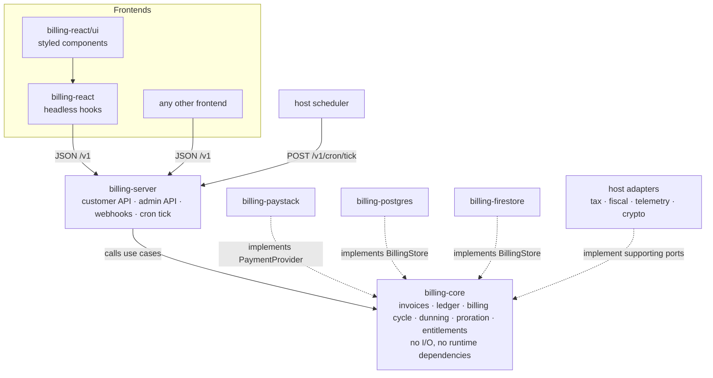
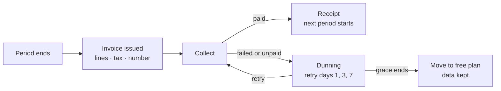

# Lotusly Billing Kit

A provider-agnostic billing SDK for TypeScript. It runs the whole billing cycle (plans, invoices, tax, collection, failed-payment recovery) inside your own app and database, and uses a payment provider only to move money.

Built for [Paystack](https://paystack.com) first, with card and M-Pesa collection in KES. PostgreSQL today, Firestore next. Ships with React components you can theme, restyle or replace.

> **Status: pre-alpha.** The architecture is settled and the code is being built in the open. Nothing here is ready for production yet. The [roadmap](#roadmap) shows what exists. APIs in this README are the target design and may change before 1.0.

---

## Contents

- [Why this exists](#why-this-exists)
- [What it does](#what-it-does)
- [Design guarantees](#design-guarantees)
- [Architecture](#architecture)
- [Packages](#packages)
- [Quick start](#quick-start)
- [How billing works](#how-billing-works)
- [Payment methods](#payment-methods)
- [Webhooks, reconciliation and the scheduler](#webhooks-reconciliation-and-the-scheduler)
- [Entitlements](#entitlements)
- [UI and theming](#ui-and-theming)
- [Server API](#server-api)
- [Extending the kit](#extending-the-kit)
- [Security](#security)
- [Operations](#operations)
- [Testing](#testing)
- [Repository layout](#repository-layout)
- [Development](#development)
- [Roadmap](#roadmap)
- [Contributing](#contributing)
- [Licence](#licence)

---

## Why this exists

Most billing libraries assume the payment provider runs your subscriptions. That works when every customer pays by card. It breaks down where many customers pay by mobile money: an M-Pesa payment has to be approved by the customer each time, so a provider cannot renew it silently, and provider-run subscriptions leave those customers out.

Lotusly Billing Kit takes the other approach:

- **The kit owns the billing cycle.** It issues each invoice, decides when and how to collect, and handles failure.
- **The provider only moves money.** It takes a payment, refunds one, or reports on one.

That makes card and mobile-money customers first-class in the same system. It also keeps invoices, tax and the ledger in your database, and reduces a provider integration to about six methods.

The kit was built for [Lotusly](#built-for-Lotusly), a multi-tenant farm management app, and is the same code that app runs.

## What it does

| Area | Included |
| --- | --- |
| Plans | Free and paid flat plans, monthly and yearly |
| Lifecycle | Trials, upgrade now with proration, downgrade at period end, cancel at period end, resume |
| Payment methods | Card with automatic renewal; M-Pesa with a payment request each period |
| Documents | Numbered invoices, receipts, credit notes |
| Ledger | Append-only double-entry record of every financial event |
| Tax | Per-line tax through a pluggable calculator; hook for fiscal registration (for example KRA eTIMS) |
| Discounts | Percent or fixed coupons, once or for N periods |
| Money back | Full and partial refunds, dispute tracking |
| Recovery | Retry schedule, reminders, grace period, automatic downgrade |
| Access | Entitlements with flags and limits, manual grants and overrides |
| Operations | Admin API, audit log, metrics, reconciliation, health endpoint |
| UI | Headless React hooks and themable styled components |

Not included yet: per-seat and usage pricing, multiple currencies per account, multiple subscriptions per account, revenue recognition schedules.

## Design guarantees

Three properties define the project. Each is enforced by a check in CI.

1. **Add a payment provider without changing the billing domain.** A provider is a separate package that implements one small interface. The core imports no provider code. *Enforced by an import-boundary lint and a shared provider contract test suite.*
2. **Switch databases without changing business logic.** The store interface offers key reads, a closed list of named queries, leases and one atomic commit, which both PostgreSQL and Firestore can do. *Enforced by one store contract suite that runs unchanged against every store.*
3. **Use the supplied UI, a customized one, or your own frontend.** There is a versioned JSON API, headless hooks, and styled components. *Enforced by building the styled layer only on the public hooks, and by an example app with no kit UI.*

## Architecture

Ports and adapters. Dependencies point inward, and nothing leaves the core.



Key decisions, each recorded in [`docs/adr`](docs/adr):

- **Kit-owned billing cycle.** Described above.
- **Status is derived, never set by an event.** A subscription's status is computed from its dates and the state of its invoices. A webhook only records a fact about one payment attempt. Late, duplicated or out-of-order webhooks therefore give the same result.
- **One atomic commit.** Every write goes through `store.commit(changeSet)`: the idempotency claim, state changes, ledger entries and outgoing events land together or not at all.
- **The kit's reference is the idempotency key.** Every provider call carries a reference the kit generated, and every provider event is matched back to it.
- **Plain SQL, not an ORM.** The Postgres store uses a three-method client interface with wrappers for `pg`, `postgres.js` and Prisma, so it shares your existing connection pool.

## Packages

| Package | What it is | Runs on |
| --- | --- | --- |
| `@lotusly/billing-core` | Domain, use cases, port definitions, `createBilling()` | Server |
| `@lotusly/billing-server` | Request handlers for the customer API, admin API, webhooks and cron tick. Next.js helper at `/next` | Server |
| `@lotusly/billing-paystack` | Paystack adapter | Server |
| `@lotusly/billing-postgres` | PostgreSQL store, SQL migrations, migration CLI | Server |
| `@lotusly/billing-firestore` | Firestore store, indexes and rules *(planned)* | Server |
| `@lotusly/billing-react` | Headless hooks and fetch client. Styled components at `/ui` | Browser |
| `@lotusly/billing-testing` | In-memory store, mock provider, fake clock, contract suites | Tests |

> Package names are provisional until the npm scope is confirmed.

## Quick start

This example uses Next.js (App Router), PostgreSQL and Paystack. The handlers are built on the Web `Request`/`Response` standard, so the same code works with Hono, Remix, Bun and Deno, and with a small shim on Express.

### 1. Install

```bash
pnpm add @lotusly/billing-core @lotusly/billing-server @lotusly/billing-paystack \
         @lotusly/billing-postgres @lotusly/billing-react
```

Requires Node.js 22.18 or later.

### 2. Run the migrations

```bash
npx lotusly-billing migrate --database-url "$DATABASE_URL"
```

This creates tables in a dedicated `billing` schema. You can also copy the SQL files from the package into your own migration tool.

### 3. Compose billing

This file is the only place that names a provider or a database.

```ts
// lib/billing.ts
import { createBilling, defineCatalog, fixedRateTax } from "@lotusly/billing-core";
import { paystack } from "@lotusly/billing-paystack";
import { postgresStore, fromPg } from "@lotusly/billing-postgres";
import { pool } from "./db";

const catalog = defineCatalog({
  entitlements: { maxFarms: "limit", seats: "limit", financials: "flag" },
  plans: [
    {
      id: "starter",
      name: "Starter",
      prices: [], // free
      entitlements: { maxFarms: 1, seats: 3, financials: false },
    },
    {
      id: "grower",
      name: "Grower",
      prices: [
        { interval: "month", amount: 250000, currency: "KES" }, // KES 2,500.00
        { interval: "year", amount: 2500000, currency: "KES" },
      ],
      entitlements: { maxFarms: 3, seats: 10, financials: true },
    },
  ],
});

export const billing = createBilling({
  catalog,
  providers: [paystack({ secretKeys: () => [process.env.PAYSTACK_SECRET_KEY!] })],
  store: postgresStore(fromPg(pool)),
  tax: fixedRateTax({ rate: "16%", pricesInclude: false }),
  dunning: {
    retryAfterDays: [1, 3, 7],
    graceDays: 7,
    whenExhausted: { moveToPlan: "starter" },
  },
  hooks: {
    onEvent: async (event) => {
      // Send receipts, reminders and failure notices here.
      // Delivered at least once; use event.id to stay idempotent.
    },
  },
});
```

Amounts are always integers in the currency's minor unit.

### 4. Mount the API

```ts
// app/api/billing/[...path]/route.ts
import { toNextHandlers } from "@lotusly/billing-server/next";
import { billing } from "@/lib/billing";
import { auth } from "@/auth";

export const { GET, POST } = toNextHandlers(billing, {
  // Required. The kit has no opinion on sessions or roles.
  resolveAccount: async () => {
    const session = await auth();
    if (!session) return null; // 401
    return {
      accountId: session.orgId,
      actorId: session.user.id,
      email: session.user.email,
      canManage: session.role === "OWNER",
    };
  },
  cronSecret: () => process.env.BILLING_CRON_SECRET!,
  allowedOrigins: [process.env.APP_URL!],
});
```

### 5. Point Paystack and your scheduler at it

- **Webhook URL** in the Paystack dashboard: `https://your-app.example/api/billing/v1/webhooks/paystack`
- **Scheduler** (Vercel Cron, Cloud Scheduler, or any worker): `POST /api/billing/v1/cron/tick` every few minutes with `Authorization: Bearer $BILLING_CRON_SECRET`

### 6. Add the UI

```tsx
"use client";
import { BillingProvider, createFetchClient } from "@lotusly/billing-react";
import { PricingTable, SubscriptionCard, PastDueBanner } from "@lotusly/billing-react/ui";
import "@lotusly/billing-react/ui/styles.css";

const client = createFetchClient({ baseUrl: "/api/billing/v1" });

export function BillingPage() {
  return (
    <BillingProvider client={client}>
      <PastDueBanner />
      <SubscriptionCard />
      <PricingTable accentColor="#2f7d4f" highlightPlan="grower" />
    </BillingProvider>
  );
}
```

### 7. Gate features on the server

```ts
if (!(await billing.can(accountId, "financials"))) {
  return new Response("Upgrade required", { status: 402 });
}

const maxFarms = await billing.limit(accountId, "maxFarms");
```

## How billing works



- **Invoices** move `draft → open → paid`, or to `void` or `uncollectible`. An open invoice is immutable. Corrections are credit notes. Numbers are sequential and allocated in the same commit as the invoice.
- **The ledger** records balanced double-entry lines for every invoice, payment, refund and write-off. Entries in one commit always sum to zero.
- **Upgrades** take effect immediately. The kit invoices a credit for unused days on the old plan and a charge for remaining days on the new one. The period end does not move.
- **Downgrades and cancellations** take effect at the period end.
- **Trials** grant full entitlements with no invoice. At the end, a saved payment method means the first invoice is collected; otherwise the account moves to the free plan.
- **Non-payment** never deletes data. Paid access continues through the retry schedule and grace period, then the account moves to the configured fallback plan.

## Payment methods

| Method | Renewal | At period end |
| --- | --- | --- |
| Card | Automatic | The kit charges the saved authorization. A decline starts dunning. |
| M-Pesa | By request | The invoice is issued ahead of the due date and the customer gets reminders with a pay link. They approve the prompt on their phone. Unpaid at the due date starts dunning. |

The kit never sees card numbers. Card entry always happens on the provider's hosted page.

## Webhooks, reconciliation and the scheduler

**Webhooks** are verified, stored raw in an inbox, and acknowledged immediately. Processing runs straight after and is retried by the scheduler until it succeeds. An event that keeps failing is marked dead, raises an alert, and can be replayed from the admin API.

**Reconciliation** covers webhooks that never arrive, in three layers:

1. When a customer returns from checkout, the kit asks the provider for the payment directly.
2. A sweep checks every payment attempt that has been pending for more than a few minutes.
3. A daily job compares the provider's payment list with the local payments table.

**The scheduler** is one endpoint your infrastructure calls. Each tick leases due work: renewals, payment requests, retries, trial endings, grant expiries, inbox and outbox draining, reconciliation. Leases make overlapping ticks safe. A missed tick delays work and loses nothing.

## Entitlements

Entitlements are what a plan unlocks: boolean flags and numeric limits that you define in the catalogue.

- Computed from the plan, any manual grants, and the subscription's status.
- Stored as a snapshot on the account in the same commit as any change, so reads never recompute.
- `billing.can()` and `billing.limit()` read through a short-lived cache.
- Enforce on the server. `<FeatureGate>` and `useEntitlement()` are for hiding UI only.

## UI and theming

Pick the level you need:

| Level | Use | You own |
| --- | --- | --- |
| Supplied UI | `@lotusly/billing-react/ui` | Colours, labels, placement |
| Customized UI | The same components with slots, or the headless hooks | Markup and styling |
| Your own frontend | The JSON API | Everything on the client |

**Hooks:** `usePlans`, `useSubscription`, `useEntitlement`, `useCheckout`, `useInvoices`, `usePaymentMethods`.

**Components:** `PricingTable`, `CheckoutButton`, `SubscriptionCard`, `InvoiceList`, `PaymentMethodCard`, `PlanChangeDialog`, `CancelDialog`, `PastDueBanner`, `TrialBanner`, `MobileMoneyPrompt`, `FeatureGate`.

Styling is plain CSS on `--lb-*` custom properties. There is no CSS-in-JS runtime.

```tsx
// Props
<PricingTable accentColor="#2f7d4f" radius="lg" density="compact" />

// Theme for a subtree
<BillingTheme theme={{ accent: "#2f7d4f", radius: 12, font: "inherit" }} colorScheme="auto">
  <SubscriptionCard />
</BillingTheme>

// Slots, labels and callbacks
<PricingTable
  classNames={{ card: "my-card", price: "text-2xl" }}
  components={{ Button: MyButton }}
  labels={{ choose: "Chagua mpango" }}
  onCheckoutError={(error) => toast(error.message)}
/>
```

```css
/* Or in your own stylesheet */
.billing {
  --lb-accent: var(--brand-600);
  --lb-radius: 10px;
}
```

Props, themes and CSS variables all set the same variables, so they never disagree.

## Server API

All routes are under `/v1`. Shapes are published as OpenAPI and as TypeScript types.

| Group | Routes | Authenticated by |
| --- | --- | --- |
| Public | `GET /plans` | None |
| Customer | `GET /state`, `/invoices`, `/payments`, `/payment-methods` · `POST /checkout`, `/reconcile`, `/subscription/change`, `/cancel`, `/resume`, `/coupon` | Your `resolveAccount` |
| Admin | `/admin/*` | Your `resolveOperator`. Absent unless configured |
| Machine | `POST /webhooks/:provider` · `POST /cron/tick` · `GET /health` | Provider signature · bearer secret · none |

Every use case is also available as a function on the `billing` object, so server code can call the kit without HTTP.

## Extending the kit

### Add a payment provider

Implement `PaymentProvider` from `@lotusly/billing-core`:

```ts
export interface PaymentProvider {
  readonly id: string;
  readonly capabilities: ProviderCapabilities;

  createCheckout(input: CheckoutInput): Promise<CheckoutResult>;
  chargeSaved?(input: SavedChargeInput): Promise<ChargeOutcome>;
  refund?(input: RefundInput): Promise<RefundOutcome>;

  // Verifies the signature, then parses. Throws on an invalid signature.
  receiveWebhook(raw: { body: Uint8Array; headers: Headers }): Promise<ProviderEvent[]>;

  fetchPayment(reference: string): Promise<ProviderPayment | null>;
  listPayments?(range: DateRange, page: PageRequest): Promise<Page<ProviderPayment>>;
}
```

Then run the contract suite against it:

```ts
import { providerContract } from "@lotusly/billing-testing";
providerContract(myProvider, { fixtures });
```

When it passes, the provider works with every store and every UI layer. See [`docs/guides/write-a-provider.md`](docs/guides/write-a-provider.md).

### Add a store

Implement `BillingStore` and run `storeContract(myStore)`. See [`docs/guides/write-a-store.md`](docs/guides/write-a-store.md).

### Other ports

`TaxCalculator`, `FiscalRegistrar`, `Telemetry`, `Crypto` and `Clock` are small interfaces you can implement for your own tax rules, e-invoicing authority, metrics stack or key management.

## Security

- Payment operations run on the server only. Server packages fail to bundle into client code.
- Webhook signatures are checked over the raw bytes, in constant time, before any parsing. The provider interface has no way to read an unverified event.
- The client chooses a plan, never a price. The paid amount and currency are checked against the stored attempt.
- Paid state changes only on information verified with the provider.
- Each provider event is applied at most once, enforced by the database in the same transaction as its effect.
- Authorization is mandatory and yours: the account id comes from your resolver, never the request body.
- State-changing routes require a JSON content type and an allowed `Origin`.
- Provider tokens are encrypted per field with a key you supply. Key lists support rotation.
- Admin actions need a permission and a reason and are written to an append-only audit log.
- The core has zero runtime dependencies. Releases are published from CI with npm provenance.

The full threat table, with a test linked from each row, is in [`docs/security.md`](docs/security.md).

**Reporting a vulnerability:** please do not open a public issue. See [`SECURITY.md`](SECURITY.md).

**Your responsibilities as an adopter** include your PCI DSS self-assessment with your provider, tax compliance in your jurisdiction, data-protection obligations, backups, and wiring the alerts.

## Operations

- **Health:** `GET /v1/health` reports database reachability, last tick time and queue ages.
- **Telemetry:** metrics, traces and structured logs through a `Telemetry` port, with an OpenTelemetry adapter. Logs use an allowlist of fields.
- **Alerts worth wiring:** signature failures, inbox age, dead events, outbox lag, time since last tick, stuck attempts, reconciliation mismatches, ledger imbalance, provider breaker open.
- **Admin API:** account timeline, grant plan or entitlement, extend trial or grace, refund, credit note, void invoice, record offline payment, retry collection, resync from provider, replay event, manage coupons.
- **Upgrades:** forward-only SQL migrations that follow expand-then-contract. The kit checks the schema version at startup and refuses to run on a mismatch.
- **Privacy:** `exportAccountData` and `anonymizeAccount`. Financial records are kept and detached from personal details.

## Testing

| Suite | Asserts |
| --- | --- |
| Domain unit tests | Status derivation, invoice lifecycle, coupons, tax, entitlements |
| Property tests | Proration and refunds never create or lose money; ledger entries always balance |
| Time-travel scenarios | A year of renewals, trials ending, dunning to exhaustion, month-end and leap-day periods |
| `storeContract` | Atomicity, duplicate claims, concurrent commits, lease exclusivity, gapless numbering |
| `providerContract` | Tampered bodies rejected; recorded fixtures map to the expected events |
| Fault injection | Dropped, duplicated and reordered webhooks, timeouts and crashes end in the same state as a clean run |
| UI tests | States, keyboard use, theming, accessibility |

`@lotusly/billing-testing` gives your own app an in-memory store, a mock provider and a fake clock, so you can test billing flows without a network or a database.

## Repository layout

```
packages/
  core/            domain, application, ports
  server/          request handlers, Next.js helper
  paystack/
  postgres/        store + migrations/*.sql
  firestore/       (planned)
  react/           hooks + ui/
  testing/
examples/
  next-postgres-paystack/   full flow, with a clock control for renewals and dunning
  headless-custom-ui/       hooks only
docs/
  adr/             architecture decision records
  guides/          write a provider, write a store, theming
  security.md
```

## Development

```bash
git clone <repo-url>
cd Lotusly-billing-kit
pnpm install
pnpm build
pnpm test                 # unit, property and contract tests
pnpm test:postgres        # store contract against Postgres in Docker
pnpm lint                 # includes the import-boundary check
```

Run the example app:

```bash
cp examples/next-postgres-paystack/.env.example examples/next-postgres-paystack/.env
# add Paystack TEST keys and a database URL
pnpm --filter next-postgres-paystack dev
```

Use Paystack test keys only. Never commit keys.

Tooling: pnpm workspaces, Turborepo, tsup, Vitest, Changesets.

## Roadmap

- [ ] **M1 Foundations:** domain (accounts, catalogue, invoices, ledger, entitlements), ports, memory store, mock provider, fake clock, contract suites
- [ ] **M2 Take a payment:** Postgres store, Paystack adapter, checkout, webhook inbox, reconciliation, server routes, example app
- [ ] **M3 Billing cycle:** scheduler, card renewals, M-Pesa requests, trials, dunning, proration, coupons, refunds, disputes, tax and fiscal ports
- [ ] **M4 Hardening:** threat-table controls and tests, admin API, audit log, telemetry, privacy functions, migration tooling
- [ ] **M5 UI:** React hooks and styled components
- [ ] **M6 1.0:** docs, hosted demo, Firestore store, port freeze

Later: per-seat and usage pricing, more currencies, community provider adapters.

## Built for Lotusly

Lotusly is a farm management app for small and medium farms. It consumes these packages from npm unchanged. What Lotusly adds privately is its plan catalogue, its notification templates, its admin screens and its tax-authority adapter, all through the ports described above. If Lotusly needs the kit to behave differently, the change is made here.

## Contributing

Issues and pull requests are welcome once M1 lands. Until then, design feedback is most useful: open a discussion or comment on an ADR.

- Read [`CONTRIBUTING.md`](CONTRIBUTING.md) first.
- Every change to a package needs a changeset (`pnpm changeset`).
- New providers and stores must pass their contract suite.
- The port interfaces are the public contract. Additions are minor releases; removals or changed meaning are major.

## Licence

[MIT](LICENSE)
